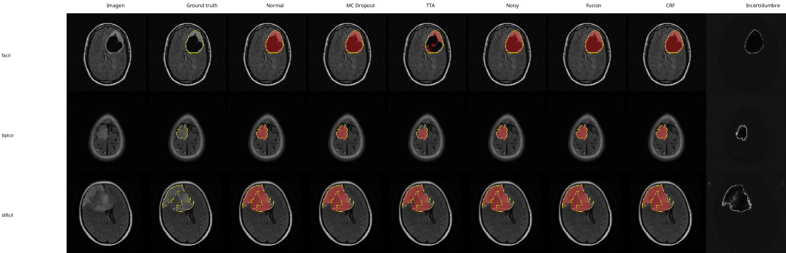
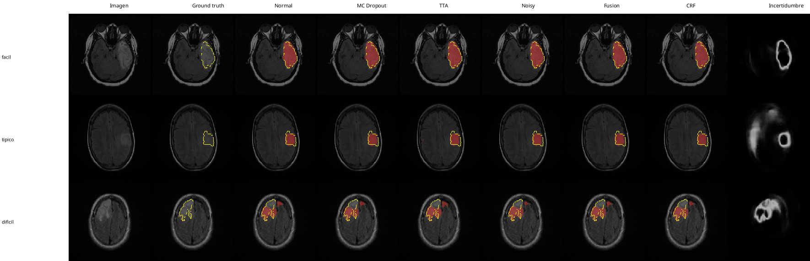
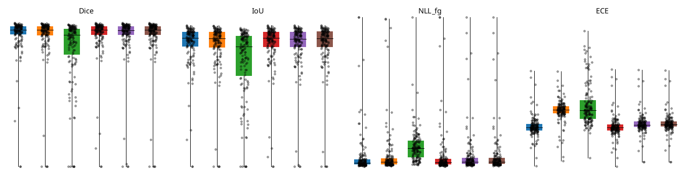
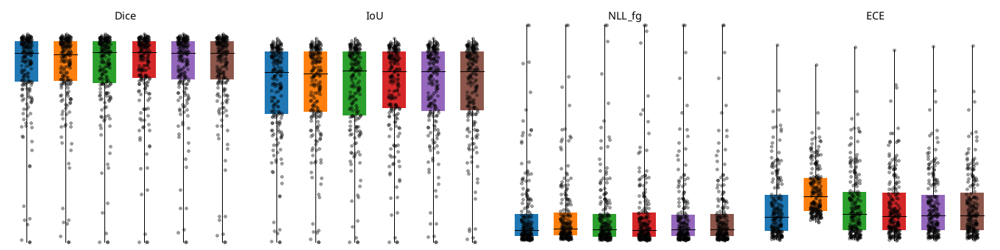

# TFM: Medical Image Segmentation with Uncertainty Estimation — Port en Rust

[](https://www.rust-lang.org/)
[](https://github.com/LaurentMazare/tch-rs)
[](https://pytorch.org)

Reimplementación completa en **Rust** (crate `tch-rs` sobre libtorch) del TFM
original en Python: *segmentation of brain MRI (LGG) with uncertainty
quantification*, comparando **UNet 2D** y **UniVerSeg few-shot** con métodos de
incertidumbre (MC Dropout, TTA, Noisy, Fusion, CRF) y split a nivel de paciente.

La versión Python original vive en `~/Desktop/Codigo_TFM` y no se modifica; este
repositorio es independiente. Véase `PLAN_rust_port.md` para las fases del port.

---

## Resultados (Rust, RTX 5080, CUDA)

### UNet 2D — 144 imágenes de test

| Método | IoU | Dice | NLL | NLL_fg | ECE |
|--------|----:|-----:|----:|-------:|----:|
| normal | 0.834 | 0.898 | 0.030 | 0.311 | 0.013 |
| mc_dropout | 0.825 | 0.888 | 0.036 | 0.350 | 0.018 |
| tta | 0.722 | 0.808 | 0.034 | 0.586 | 0.019 |
| noisy | 0.832 | 0.895 | 0.030 | 0.323 | 0.013 |
| fusion | 0.829 | 0.890 | 0.030 | 0.332 | 0.013 |
| crf | 0.829 | 0.890 | 0.030 | 0.331 | 0.014 |

### UniVerSeg (canal G T1c, contexto 64)

| Scope | normal Dice | fusion Dice | normal ECE |
|-------|------------:|------------:|-----------:|
| support (64, vistas en contexto) | 0.942 | 0.941 | 0.003 |
| test (144, pacientes no vistos) | 0.761 | 0.768 | 0.011 |

| Método (test) | IoU | Dice | ECE |
|---------------|----:|-----:|----:|
| normal | 0.724 | 0.761 | 0.011 |
| mc_dropout | 0.725 | 0.762 | 0.015 |
| tta | 0.727 | 0.765 | 0.012 |
| noisy | 0.731 | 0.770 | 0.011 |
| fusion | 0.729 | 0.768 | 0.011 |
| crf | 0.729 | 0.767 | 0.011 |

### Figuras cualitativas y distribuciones

Paneles cualitativos (casos fácil/típico/difícil por percentil de Dice; columnas:
imagen, ground-truth, máscara por método y mapa de incertidumbre de la fusión —
rojo = máscara predicha, amarillo = contorno del ground-truth):




Distribución de métricas por método (box + jitter):




Tests pareados a nivel de paciente (bootstrap por clusters + Wilcoxon):


---

## Quick Start

```bash
# Build (libtorch 2.13.0+cu130 vendored en ./libtorch; ver .cargo/config.toml)
cargo build --release -p app --bins

# UNet (144 test)
./scripts/run.sh ./target/release/run_unet --config configs/pipeline_2d.yaml

# UniVerSeg few-shot (contexto 64) — support + test
./scripts/run.sh ./target/release/run_foundation --config configs/foundation_universeg.yaml --context-size 64

# Estadística a nivel de paciente (bootstrap + Wilcoxon exacto)
./scripts/run.sh ./target/release/statistics --pipeline all

# Figuras (docs/*.png)
./scripts/run.sh ./target/release/make_figures --results-dir ./results --out-dir ./docs --tag unet
./scripts/run.sh ./target/release/make_figures --results-dir ./results_foundation_universeg --out-dir ./docs --tag universeg --sample-prefix test_

# Entrenar UNet (opcional; pesos ya incluidos en unet_model.safetensors)
./scripts/run.sh ./target/release/train_unet --data-root ./MRI/filtered_data --epochs 60

# Tests
cargo test --workspace
```

> **CUDA en runtime**: libtorch 2.13 descarta `libtorch_cuda.so` por el
> `--as-needed` del linker, así que hay que precargarlo. `scripts/run.sh` fija
> `LD_PRELOAD` + `LD_LIBRARY_PATH`. En setups solo-CPU no hace falta.

Los pesos (`unet_model.safetensors`, `universeg.safetensors`) se exportan desde
la versión Python con `scripts/export_safetensors.py` (una única vez).

## Métodos de incertidumbre

| Método | Descripción | UNet | UniVerSeg |
|--------|-------------|:----:|:---------:|
| **Normal** | Una pasada | ✓ | ✓ |
| **MC Dropout** | 30 pasadas con dropout Bernoulli (p=0.01) inyectado en `forward` | ✓ | ✓ |
| **TTA** | UNet: 30 combinaciones (flip + escala + intensidad). UniVerSeg: 9 transformaciones fotométricas (resize-safe) | ✓ | ✓ |
| **Noisy** | 30 pasadas con ruido gaussiano (σ=0.01 UNet / 0.1 UniVerSeg) | ✓ | ✓ |
| **Fusion** | Media ponderada por incertidumbre (inverse weighting) de MC+TTA+Noisy | ✓ | ✓ |
| **CRF** | Dense CRF mean-field (kernels gaussiano + bilateral, 3 iteraciones, parada en bordes) | ✓ | ✓ |

## Comparativa con la versión Python

Misma GPU (RTX 5080), mismos datos y pesos (Python: torch 2.12.1+cu130; Rust:
`tch` 0.26 / libtorch 2.13.0+cu130).

**Tiempo de pared** (pipeline completo, escritura de PNG/CSV incluida):

| Pipeline | Python | Rust | Aceleración |
|----------|-------:|-----:|:-----------:|
| UNet — 5 imágenes | 8.89 s | 4.89 s | ~1.8× |
| UNet — 144 test | 1:48.0 min | 1:44.3 min | ~1.03× |
| UniVerSeg — 64+144 | 15:12.9 min | 13:57.6 min | ~1.09× |

**Memoria máx. (RSS)**:

| Pipeline | Python | Rust |
|----------|-------:|-----:|
| UNet — 144 test | 1.75 GB | 1.30 GB |
| UniVerSeg — 64+144 | 1.68 GB | 1.26 GB |

La aceleración ~1.8× solo aparece en ejecuciones cortas (Rust evita el arranque
de Python: imports + carga del modelo + *warm-up* de kernels CUDA). En
ejecuciones completas ambas versiones están dominadas por los kernels CUDA de
libtorch, por lo que el tiempo es casi idéntico (Rust ~3–9 % más rápido) y la
ventaja principal pasa a ser la memoria (**−25 %**).

**Optimización** (`opt-level=3` + `lto="fat"` + `codegen-units=1`): mejora ~3.5 %
(4.89 s → 4.72 s en 5 imágenes) porque el cuello de botella es CUDA, no el
código Rust. El único componente en Rust puro (el CRF) sí se beneficia de
`-C target-cpu=native`.

**Precisión (determinista, modo `eval()`)**:

| Método | Concordancia |
|--------|--------------|
| `normal` | Dice/IoU **bit a bit**; NLL/ECE hasta ~1e-8 |
| `mc_dropout`/`tta`/`noisy` | Dentro del ruido de 30 muestras |
| Wilcoxon exacto | p-valores **bit a bit** |
| `split_by_patient(seed=42)` | Reproduce `test_indices.json` exactamente |

Frente a los CSVs versionados:

| Pipeline | Δ Dice (normal) | Δ IoU (normal) | Δ ECE (normal) |
|----------|----------------:|---------------:|---------------:|
| UniVerSeg | 0.0099 | 0.0146 | 0.0005 |
| UNet | 0.0445 | 0.0566 | 0.0032 |

El port de **UniVerSeg coincide casi exactamente** (Dice ~1 %, ECE ~5e-4,
máscaras idénticas: MAE 0.00000). El **UNet difiere más** porque el
`run_unet.py` original omite `model.eval()` (BatchNorm en modo entrenamiento) y
usa un checkpoint más antiguo que el versionado. Con `eval()`, el port reproduce
Python bit a bit (ej.: Dice muestra 2 = `0.8221635883905013` en ambos).

## Estadística

Tests pareados a nivel de paciente (bootstrap por clusters 10.000 iteraciones +
Wilcoxon signed-rank exacto) sobre `visualizations/detailed_metrics.csv`.
Resultados en `visualizations/statistical_tests.csv` y en el forest plot de
arriba. p-valores coinciden **bit a bit** con scipy (método exacto, n≤25).

## Estructura del proyecto

```
├── crates/
│   ├── core/ (tfm-core)            ─ SIN tch: compila y testea sin libtorch/CUDA
│   │   ├── src/ (metrics, fusion, crf, dataset, config, statistics, pyrandom, io)
│   │   └── tests/                  ─ 57 tests
│   └── app/ (app)                  ─ CON tch
│       ├── src/
│       │   ├── models/             ─ unet.rs + universeg.rs + carga safetensors
│       │   ├── uncertainty/        ─ mc_dropout.rs, tta.rs, noise.rs
│       │   ├── pipelines/          ─ base.rs (orquestación + guardado)
│       │   ├── tensor_util.rs      ─ tensor↔ndarray, carga TIFF/PNG
│       │   ├── viz.rs              ─ plotters (barras, box, forest, paneles)
│       │   └── bin/                ─ run_unet, run_foundation, train_unet, statistics, make_figures
│       └── tests/                  ─ 4 tests numéricos (forward vs TorchScript < 1e-5)
├── configs/                        ─ YAML (pipeline_2d, foundation_universeg, *_4pct)
├── scripts/
│   ├── run.sh                      ─ wrapper LD_PRELOAD/libtorch para CUDA
│   ├── download_data.sh            ─ descarga del dataset
│   ├── export_safetensors.py       ─ UNet/UniVerSeg → .safetensors (desde el .venv original)
│   └── export_torchscript.py       ─ traza ambos → .pt (referencia para tests numéricos)
├── docs/                           ─ figuras (paneles cualitativos, distribuciones, forest)
├── libtorch/                       ─ libtorch 2.13.0+cu130 vendored (gitignored, ~1 GB)
├── MRI/filtered_data/              ─ dataset filtrado (1%, ~1060 imágenes, 108 pacientes)
├── test_indices.json               ─ 144 índices de test (split por paciente, seed=42)
└── *.safetensors                   ─ pesos (unet_model, universeg)
```

## Tests

```bash
cargo test --workspace    # 61 tests (57 core + 4 modelos numéricos vs TorchScript)
```

## Requirements

- Rust ≥1.99, libtorch 2.13.0+cu130 (vendored en `./libtorch`) para `crates/app`
- CUDA ≥12.8 (GPU Blackwell sm_120); `crates/core` compila y testea sin CUDA
- La versión Python original (solo para exportar pesos) usa torch ≥2.5 en `~/Desktop/Codigo_TFM`

## Citation

```bibtex
@mastersthesis{GonzalezSalas2025,
  author  = {Fernando González Salas},
  title   = {Medical Image Segmentation with Uncertainty Estimation},
  school  = {Universidade de Santiago de Compostela},
  year    = {2025}
}
```
